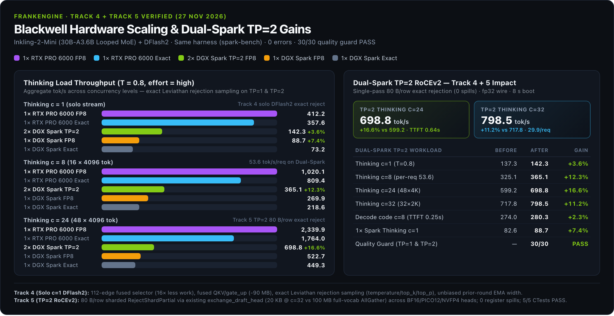

<p align="center">
  <picture>
    <source media="(prefers-color-scheme: dark)" srcset="docs/assets/frankengine-lockup-dark.png">
    
  </picture>
</p>

Frankengine is a C++/CUDA inference engine for **`Inkling-2-Mini` (`30B-A3.6B` Looped MoE)** on NVIDIA Blackwell GPUs — **RTX 5090 / RTX PRO 6000 (`sm_120a`)**, **1× and 2× DGX Spark (`sm_121a`, RoCEv2 TP=2)**, and **B200 / GB200 (`sm_100a`)**. It supports both **FP8** and **100% bit-exact lossless (`PICO12 + CERT_HEAD`)** modes, native **Vision ON**, `256K` context, `BatchDFlash2` (`GAMMA=7`) with AngelSpec `D-cut` and zero-logit-buffer single-pass exact rejection sampling, and an OpenAI-compatible HTTP/SSE server.

<p align="center">
  
</p>

<p align="center">
  
</p>

## Highlights

Measured with [`knapcio/inkling-2-mini-spark-bench`](https://github.com/knapcio/inkling-2-mini-spark-bench) (`0` errors, `128K` + `240K` needles `PASS`, `30/30` quality guard `PASS`):

| Hardware & Preset | Lossy? | ALL 73 / Guard (`c1`) | Thinking `c1` | Thinking `c8` | Thinking `c24` | Startup | Quality (`/295`) |
|---|---|---:|---:|---:|---:|---:|---:|
| **1× RTX PRO 6000 96 GB (FP8)** | Yes (`FP8`) | **`398.4 tok/s`** | **`412.2`** | **`1,020`** | **`2,340`** | **`3 s`** | `30/30 PASS` |
| **1× RTX PRO 6000 96 GB (`PICO12 + CERT`)** | **No (bit-exact)** | **`365.9 tok/s`** | **`357.6`** | **`809`** | **`1,764`** | **`4 s`** | `30/30 PASS` |
| **2× DGX Spark GB10 (`TP=2` RoCEv2, FP8)** | Yes (`FP8`) | **`136.4 tok/s`** *(guard)* | **`142.3`** | **`365`** | **`699`** *(c32 `799`)* | **`8 s`** | `30/30 PASS` |
| **1× DGX Spark GB10 (FP8, Vision ON)** | Yes (`FP8`) | **`87.2 tok/s`** *(med `82.5`)* | **`86.4`** | **`259`** | **`553`** | **`8 s`** | `285.7` |
| **1× DGX Spark GB10 (`PICO12 + CERT`, Vision ON)** | **No (bit-exact)** | **`77.1 tok/s`** *(med `76.7`)* | **`73.2`** | **`219`** | **`449`** | **`10 s`** | **`286.0`** |

Full tables (including `2× DGX Spark TP=2` RoCEv2, `Decode Table`, `Decode @32K/@128K`, and Persistent Prefix Cache): [**Benchmarks**](docs/BENCHMARKS.md).

## Requirements

- Linux (`x86_64` or `aarch64`) with an NVIDIA Blackwell GPU (`sm_120a`, `sm_121a`, or `sm_100a`).
- NVIDIA driver ≥ 580 and **CUDA Toolkit 13.0+**.
- CMake 3.24+, GCC 12+, Python 3.10+, and `huggingface_hub` (`hf`).

## Quick start

```bash
# 1. Clone and download weights (~21.2 GB total)
git clone https://github.com/Alexintosh/Frankengine.git && cd Frankengine
hf download thinkingmachines/Inkling-2-Mini --local-dir models/Inkling-2-Mini
hf download incoai/Inkling-2-Mini-DFlash2 \
  --revision 4f9088ea66c21f2b99ed657d1941c306b03e84d2 \
  --local-dir models/Inkling-2-Mini-DFlash2

# 2. Build TP=1 (ARCH=120a for RTX 5090 / PRO 6000, 121a for DGX Spark, 100a for B200)
export ARCH=120a
cmake -S engine/native -B "engine/native/build-${ARCH}" \
  -DCMAKE_BUILD_TYPE=Release -DCMAKE_CUDA_ARCHITECTURES="$ARCH" \
  -DINKLING_COMM_SOURCE_DIR="" -DINGINE_BUILD_TESTS=OFF
cmake --build "engine/native/build-${ARCH}" -j "$(nproc)" \
  --target ingine-serve ingine-bench ingine-batch-bench ingine-validate

# 3. Serve OpenAI-compatible API on http://127.0.0.1:8834/v1
#    (Add DENSE_FP8=0 KV_FP8=0 HEAD_NVFP4=0 DENSE_PICO12=1 CERT_HEAD=1 for 100% bit-exact lossless)
BUILD_DIR="$(pwd)/engine/native/build-${ARCH}" \
HEAD_MODEL_DIR="$(pwd)/models/Inkling-2-Mini" \
DFLASH2_DIR="$(pwd)/models/Inkling-2-Mini-DFlash2" \
./scripts/serve_tp1.sh
```

- **32 GB RTX 5090 / autonomous setup:** see [RTX 5090 & Blackwell Runbook](docs/RTX5090_AGENT_RUNBOOK.md).
- **One-command Google Colab G4 (RTX PRO 6000 96 GB) + `sparkDash`:** see [Colab G4 Guide](scripts/colab-g4/README.md).
- **Dual-Node `2× DGX Spark` (`TP=2` RoCEv2):** configure `scripts/local.sh` from `scripts/local.sh.example`, build with `-DINKLING_COMM_SOURCE_DIR="$(pwd)/tp_comm"`, and run `./scripts/serve_tp2.sh` ([TP=2 Architecture](docs/tp2_architecture.md)).

## Documentation

- **Run & Deploy:** [RTX 5090 / Blackwell Runbook](docs/RTX5090_AGENT_RUNBOOK.md), [Google Colab G4 (RTX PRO 6000)](scripts/colab-g4/README.md), [Parallel Coding Fan-Out Extension](.omp/extensions/frankengine-parallel.ts).
- **Benchmarks:** [Full Benchmarks (RTX PRO 6000, 1× & 2× DGX Spark)](docs/BENCHMARKS.md), [`scripts/bench_matrix.py`](scripts/bench_matrix.py).
- **Architecture & Kernels:** [Architecture & Kernel Overview](docs/ARCHITECTURE.md), [TP=2 RoCEv2 Architecture](docs/tp2_architecture.md), [Optimization Roadmap & Ledger](docs/OPTIMIZATION_ROADMAP.md), [Hardware Scaling & Megakernel Audit](docs/hardware_scaling_and_megakernel_audit.md).
- **Qualification Reports:** [TP=2 Unified Qualification](reports/phase_c_tp2_unified_qualification.md), [TP=1 Qualification](reports/track1_tp1_frankengine.md), [Continuous Batching](reports/track2a_continuous_batching.md), [Prefill Roofline Audit](reports/track2c_prefill_accel.md).

## Credits

- **Engine Lineage (Apache-2.0):** forked from [`satellitedown/inkling-2-mini-abliterated-ingine`](https://github.com/satellitedown/inkling-2-mini-abliterated-ingine) (`ingine`, base `556acc7`), building on [`fngine`](https://github.com/satellitedown/fngine), [`cinference`](https://github.com/satellitedown/cinference), and [`Neroued/ninfer`](https://github.com/Neroued/ninfer).
- **Models & Drafters (Apache-2.0):** [`thinkingmachines/Inkling-2-Mini`](https://huggingface.co/thinkingmachines/Inkling-2-Mini) and [`incoai/Inkling-2-Mini-DFlash2`](https://huggingface.co/incoai/Inkling-2-Mini-DFlash2).
- **Benchmarks & Methodology:** [`knapcio/inkling-2-mini-spark-bench`](https://github.com/knapcio/inkling-2-mini-spark-bench), [`Tencent/AngelSpec`](https://github.com/Tencent/AngelSpec), [`jesdga95/basalt`](https://github.com/jesdga95/basalt), [`tonyd2wild/Inkling-2-Mini-NVFP4-DGX-Spark`](https://github.com/tonyd2wild/Inkling-2-Mini-NVFP4-DGX-Spark), and [`sybil-solutions/inference-optimisation-skill`](https://github.com/sybil-solutions/inference-optimisation-skill).
- **Third-Party Libraries:** all vendored dependencies and notices are listed in [`NOTICE`](NOTICE).

## License

Apache License 2.0 — see [`LICENSE`](LICENSE) and [`NOTICE`](NOTICE).

*Unofficial community project; not affiliated with or endorsed by Thinking Machines, Inco AI, or NVIDIA.*
