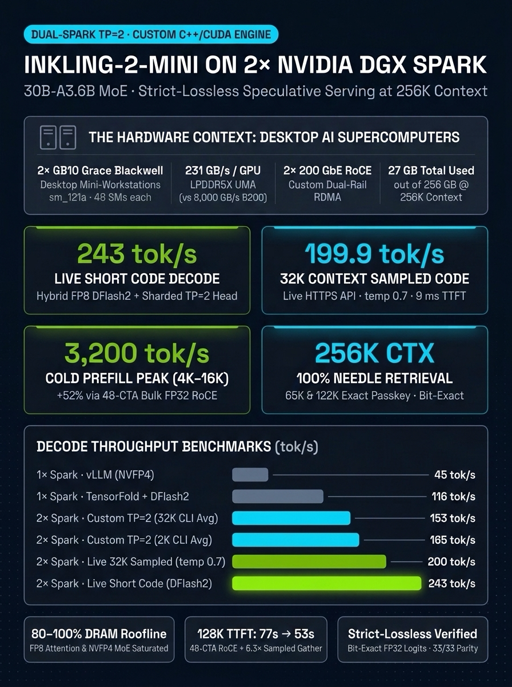

# Frankengine

**High-throughput, strict-lossless C++/CUDA inference engine for `Inkling-2-Mini` (`30B-A3.6B` Looped MoE) on NVIDIA Blackwell GPUs (`GB10` DGX Spark `sm_121a`, `RTX 5090`/`PRO 6000` `sm_120`, and `B200`/`GB200` `sm_100a`).**

Built on top of upstream [`ingine`](https://github.com/satellitedown/inkling-2-mini-abliterated-ingine), Frankengine adds a custom **dual-rail 200 GbE RoCE UMA RDMA collective backend (`tp_comm/`)**, **Tensor Parallel (`TP=2`)** execution, **sharded `NVFP4` LM head**, **eager-captured `FP8` Graph `DFlash 2` block-diffusion drafting**, **context-aware hybrid speculation (`DFlash 2` + global `DSpark`)**, and **256K live OpenAI-compatible serving**.

<p align="center">
  
</p>

---

## Verified Production Benchmarks (`2× NVIDIA DGX Spark`, GB10 `sm_121a`)

Each DGX Spark (`GB10`) has **128 GB LPDDR5X unified memory** with **`231.38 GB/s` measured streaming DRAM bandwidth** (vs. `1,792 GB/s` RTX 5090 / `8,000 GB/s` NVIDIA B200), linked via dual-rail 200 GbE RoCE.

### Live OpenAI HTTPS Serving (`256K` Context, `DRAFT_TYPE=hybrid`)
| Workload | Prefill / TTFT | Decode Throughput | Notes |
|---|---:|---:|---|
| **Short Code (greedy, `DFlash 2`)** | `88 ms` (`36` tok) | **`243.1 tok/s`** | `248.7 tok/s` warm (`2 ms` TTFT, `400` tok) |
| **32K Context Sampled Code (`temp=0.7`)** | **`9 ms`** (prefix cache) | **`199.9 tok/s`** | Live OpenAI API, thinking off |
| **Short Code Sampled (`temp=0.7`, thinking on)** | `141 ms` | **`161.8 tok/s`** | Exact TP=2 sampled head (`6.3×` 32-CTA gather) |
| **Cold Prefill (`4K / 8K / 16K`)** | `1.39 / 2.76 / 5.43 s` | — | **`3,200 / 3,097 / 3,081 tok/s`** |
| **Real Multi-Turn Coding Agent (`24K–27K` ctx)** | `86–208 ms` | **`125–220 tok/s`** | Prefix-cache `extend` hit every turn |
| **Needle-in-a-Haystack (`65.5K` / `121.6K` live)** | `23.7 / 47.4 s` | **`181.6 / 129.2 tok/s`** | **100% exact passkey retrieval** (`27.2 GiB` / `256 GiB` used) |

### Interleaved CLI Qualification (`M5 Baseline → Unified TP=2`)
| Workload | M5 Baseline | Unified TP=2 (`hybrid`) | Delta | Parity |
|---|---:|---:|---:|---|
| **Built-in Chat** (6-run median) | `120.4 tok/s` | **`158.6 tok/s`** (`α+1=3.82`) | **`+31.7%`** | `33/33` golden in all modes |
| **Built-in Code** (6-run median) | `124.9 tok/s` | **`135.1 tok/s`** (`α+1=3.00`) | **`+8.2%`** | `65/66` top-1, `KL 0.001927` |
| **2K** (Cold Prefill / Decode) | `1,755` / `165.4 tok/s` | **`2,613` / `165.3 tok/s`** | **`+48.9%` prefill** | `768/768` exact IDs |
| **32K** (Cold Prefill / Decode) | `1,841` / `153.6 tok/s` | **`2,802` / `153.1 tok/s`** | **`+52.2%` prefill** | `768/768` exact IDs |
| **128K** (Cold Prefill / Decode) | `1,694` (`77.4s`) / `102.7` | **`2,471` (`53.0s`) / `102.3`** | **`+45.9%` (`-24.3s`)** | `512/512` exact IDs |

- **Strict-lossless verified:** `52,815,312`-byte FP32 target logit dump is **SHA-256 byte-identical** to baseline; all 28 target GEMV kernels and decode RoCE collectives match stock SASS byte-for-byte.
- **Physical DRAM saturation on GB10:** `NVFP4 MoE W13` ~96%, `FP8 Full Attn (32K–128K)` 94–101%, `FP8 Wproj` 90–91%, `NVFP4 LM Head` ~90%.

---

## Repository Layout

```text
Frankengine/
├── engine/         # C++/CUDA Blackwell engine (ingine-tp: TP=2 + TP=1, NVFP4/FP8/MXFP8, DSpark + DFlash 2)
├── tp_comm/        # Custom dual-rail RoCE UMA RDMA backend (48-CTA bulk FP32 AllReduce + 32-CTA 6.3x gather)
├── scripts/        # Generic TP=2 CLI & server launchers (config.sh, local.sh.example, run_tp2.sh, serve_tp2.sh, llmstat)
├── docs/           # Engineering roadmap, TP=2 architecture, B200/GB200 Megakernel scaling audit, infographic
├── reports/        # Full interleaved qualification & ablation reports
├── LICENSE         # Apache-2.0
└── NOTICE          # Full upstream and third-party copyright & license attributions
```

---

## Quickstart (`2× DGX Spark`, `sm_121a`)

### 1. Build Engine & `tp_comm`
```bash
cmake -S engine/native -B engine/native/build-gb10-tp \
  -DCMAKE_BUILD_TYPE=Release \
  -DCMAKE_CUDA_COMPILER=/usr/local/cuda/bin/nvcc \
  -DCMAKE_CUDA_ARCHITECTURES=121a \
  -DINKLING_COMM_CUDA_ARCHITECTURES=121a \
  -DINKLING_COMM_SOURCE_DIR="$(pwd)/tp_comm" \
  -DINGINE_BUILD_TESTS=ON

cmake --build engine/native/build-gb10-tp -j 12 \
  --target ingine-serve ingine-bench ingine-validate
```

### 2. Configure Your Cluster Nodes (Gitignored Local Override)
```bash
cp scripts/local.sh.example scripts/local.sh
# Edit scripts/local.sh with your worker SSH alias, model paths, and RoCE rendezvous IP
```

### 3. Serve Live (`256K` Context + Hybrid `DFlash 2` / `DSpark`)
```bash
./scripts/serve_tp2.sh
```
Measure live TTFT, prefill, and decode throughput from any `curl` command using the bundled [`scripts/llmstat`](scripts/llmstat):
```bash
curl -sSN http://127.0.0.1:8834/v1/chat/completions \
  -H 'Content-Type: application/json' \
  -d '{
    "model": "inkling-2-mini",
    "messages": [{"role": "user", "content": "Write a concise Python LRU cache class using OrderedDict with get and put methods."}],
    "temperature": 0,
    "max_tokens": 160,
    "enable_thinking": false,
    "stream": true,
    "stream_options": {"include_usage": true}
  }' | ./scripts/llmstat
```

---

## Key Documentation
- [**`docs/OPTIMIZATION_ROADMAP.md`**](docs/OPTIMIZATION_ROADMAP.md) — Living experiment ledger (`EXP-001`–`EXP-023`), byte-level roofline audits, dead-end registry, and optimization roadmap.
- [**`docs/hardware_scaling_and_megakernel_audit.md`**](docs/hardware_scaling_and_megakernel_audit.md) — Calibrated hardware scaling projections (`RTX 5090/PRO 6000` → `1×/8× B200` → `GB200 NVL72` → `Vera Rubin`) and microsecond-by-microsecond Megakernel engineering verdict.
- [**`docs/tp2_architecture.md`**](docs/tp2_architecture.md) — Tensor-parallel sharding and RoCE collective design.
- [**`reports/phase_c_tp2_unified_qualification.md`**](reports/phase_c_tp2_unified_qualification.md) — Final interleaved CLI, live SSE, SASS parity, and 65K/122K needle qualification report.

---

## Credits & Code Lineage

Frankengine stands on the shoulders of outstanding open-source work. All original licenses and copyright notices are preserved in [`LICENSE`](LICENSE) and [`NOTICE`](NOTICE):

### Core Engine Lineage (Apache License 2.0)
1. **[`Neroued/ninfer`](https://github.com/Neroued/ninfer) (NInfer)** — Foundational C++/CUDA inference engine design.
2. **[`satellitedown/cinference`](https://github.com/satellitedown/cinference)** (commit `383e5db`) — C++ engine evolution derived from NInfer.
3. **[`satellitedown/fngine`](https://github.com/satellitedown/fngine)** — CUDA-graph runtime, weight-loading, OpenAI HTTP server, and Jinja/tokenizer pipeline.
4. **[`satellitedown/inkling-2-mini-abliterated-ingine`](https://github.com/satellitedown/inkling-2-mini-abliterated-ingine) (`ingine`, base commit `556acc7`)** — Single-GPU `sm_120a` Blackwell C++/CUDA engine for `Inkling-2-Mini` (NVFP4/MXFP8 MoE kernels, FP8 dense projections, prefill, DSpark speculative loop, and OpenAI server) from which Frankengine's `engine/` directory is forked and extended for `sm_121a`, `TP=2`, sharded NVFP4 head/drafter, and hybrid `DFlash 2`.

### Models & Speculative Drafters
- **[`thinkingmachines/Inkling-2-Mini`](https://huggingface.co/thinkingmachines/Inkling-2-Mini)** (Thinking Machines, Apache-2.0) — Base `30B-A3.6B` looped MoE model and `DSpark` (`mtp.safetensors`) drafter.
- **[`incoai/Inkling-2-Mini-DFlash2`](https://huggingface.co/incoai/Inkling-2-Mini-DFlash2)** (Inco AI, Apache-2.0) — 0.5B 5-layer parallel block-diffusion drafter weights and architecture implemented natively in Frankengine's FP8 CUDA-graph + TP=2 sharded NVFP4 head path.

### Benchmarks, Architecture Cross-Checks & Methodology
- **[`slatesys/lunomi-inkling`](https://github.com/slatesys/lunomi-inkling) (Basalt)** — Reference RTX 5090 Inkling-2-Mini engine comparisons and optimization insights.
- **[`tonyd2wild/Inkling-2-Mini-NVFP4-DGX-Spark`](https://github.com/tonyd2wild/Inkling-2-Mini-NVFP4-DGX-Spark)** — Single-Spark vLLM + TensorFold + DFlash 2 reference benchmarks.
- **[`sybil-solutions/inference-optimisation-skill`](https://github.com/sybil-solutions/inference-optimisation-skill)** — Disciplined roofline-first, noise-controlled interleaved A/B hill-climbing and full-context qualification methodology.

### Vendored Third-Party Dependencies (`engine/native/third_party/`)
All vendored libraries retain their original licenses and copyright notices (see [`NOTICE`](NOTICE)): `cpp-httplib` (MIT), `libwebp` (BSD-3-Clause), `llama-jinja` (MIT), `nlohmann/json` (MIT), `spdlog`/`fmt` (MIT), `stb_image` (MIT/PD), and `utf8proc` (MIT).

*Unofficial community project; not affiliated with or endorsed by Thinking Machines, Inco AI, or NVIDIA.*
