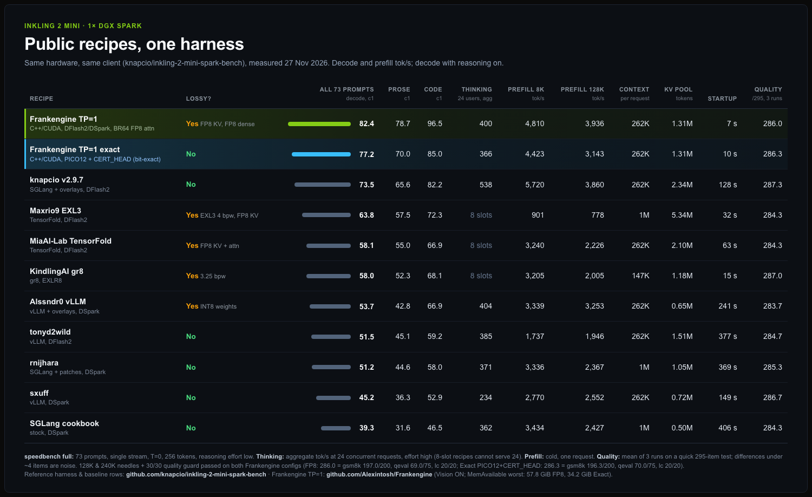

# Frankengine

**High-throughput, strict-lossless C++/CUDA inference engine for `Inkling-2-Mini` (`30B-A3.6B` Looped MoE) on NVIDIA Blackwell GPUs (`GB10` DGX Spark `sm_121a`, `RTX 5090`/`RTX PRO 6000` `sm_120a`, and `B200`/`GB200` `sm_100a`).**

Built on top of upstream [`ingine`](https://github.com/satellitedown/inkling-2-mini-abliterated-ingine) and [`ingine-batch`](https://github.com/satellitedown/ingine-batch), Frankengine combines:
- **Native Blackwell Kernels & Prefill v3:** `mxf4nvf4`/`mxf8f6f4` Tensor Core prefill MoE, custom `mma.sync.m16n8k32` FP8 dense prefill GEMM (`149.4 TFLOP/s`, fused `OUTER_VEC_32F` epilogue), `BR64_BK64` `ldmatrix.b8.trans` FP8 global prefill attention (`3,936 tok/s` cold 128K prefill on `1× DGX Spark`), fused BF16 `gate_fg_apply`, BF16 MMA `rel_logits`, and fused `NVFP4` LM head (`head_sample_nvfp4` / `head_topk16_nvfp4`).
- **Bit-Exact 100% Lossless Mode (`PICO12` + `CERT_HEAD`):** Lossless 12-bit BF16-native dense weight packing (`--dense-pico12`, 75.1% of BF16 weight bytes with exact per-row CSR outliers and 7-op `decode4`, 0 bits error) paired with a mathematically certified Cauchy-Schwarz greedy LM head (`--cert-head`, NVFP4 proxy + exact dense verification of all suspect rows, 100% bit-exact greedy parity) — reaching **`77.2 tok/s` `all-73` lossless (`85.0` code, `70.0` prose)** on `1× DGX Spark`.
- **Dual-Rail 200 GbE RoCEv2 UMA Backend (`tp_comm/`):** 48-CTA FP32/BF16 AllReduce, CUDA-Graph-safe `K=4` pipelined bulk RDMA (`>=8 MiB`), `bf16-moe` wire (`Wo` stays FP32 for conv1d precision), and `6.3×` 32-CTA sampled gather.
- **50/50 `TP=2` Sharded Solo `DFlash 2` + Hybrid Speculation:** Megatron-sharded 5-layer FP8/NVFP4 `DFlash 2` backbone (`-22.9%` draft latency, broadcast-free in-graph sharded NVFP4 head) paired with global `DSpark` (`--draft-type hybrid --dflash2-max-ctx 6144`).
- **`BatchDFlash2` (`GAMMA=7`) & `c=32` CUDA Graphs:** 5-layer batched block-diffusion drafter (`MXFP8` + `FP8` KV rings = `1.545 GB` for 32 slots, WMMA GQA, auto-selected when `--dflash2-dir` and `--batch-spec >= 5`), `32 × 32K` continuous batching, and automatic `256K` solo fallback.
- **GPU `clone_slot` Forking + Zero-VRAM Persistent Prefix Cache:** Automatic intra-wave shared-prefix slot cloning plus an LRU Prefix Anchor pool (detecting `<|end_message|>` / `<|im_end|>` boundaries) that cuts repeated system-prompt TTFT by up to **`19.9×`**.
- **Vision ON (`TP=1`) + Live Observability & Parallel Agent Fan-Out:** Built-in ViT multimodal support enabled by default on `TP=1`, lock-free `GET /v1/telemetry` (JSON) & `GET /metrics` (Prometheus) endpoints + bundled [`.omp/extensions/frankengine-parallel.ts`](.omp/extensions/frankengine-parallel.ts) for single-chat multi-lane coding fan-out.

<p align="center">
  
</p>

---

## Verified Production Benchmarks (`1×` vs `2× NVIDIA DGX Spark`, GB10 `sm_121a`)

Each DGX Spark (`GB10`) has **128 GB LPDDR5X unified memory** with **`231.38 GB/s` measured streaming DRAM bandwidth** (vs. `1,792 GB/s` RTX 5090 / `8,000 GB/s` NVIDIA B200), linked via dual-rail 200 GbE RoCEv2 (`bf16-moe` wire, `BATCH_SPEC=7`, `BATCH_SPEC_THRESHOLD=0.30`).

### 0. `1× DGX Spark` (`TP=1`) Same-Harness Leaderboard (`knapcio/inkling-2-mini-spark-bench`, Vision ON)

Measured on `1× NVIDIA DGX Spark (GB10)` with the exact public 7-step `cmpbench.sh` harness (`speedbench full` 73 prompts `T=0` reasoning low, `thinking c24`, `longctx`, `128K` + `240K` needles, `30/30` quality guard, and 3-seed `295`-item `inkqc` quality):

| Recipe (`1× DGX Spark`) | Lossy? | ALL 73 (`c1`) | Prose (`c1`) | Code (`c1`) | Thinking (`c24`) | Prefill `8K` | Prefill `128K` | Decode `@32K / 128K` | Startup | Quality (`/295`) |
|---|---|---:|---:|---:|---:|---:|---:|---:|---:|---:|
| **Frankengine TP=1 (FP8, Vision ON)** | Yes (`FP8 KV/dense`) | **`82.4 tok/s`** *(geo `86.2`)* | **`78.7`** | **`96.5`** | `400` | `4,810` | **`3,936`** | **`90.9 / 58.5`** | **`7 s`** | `286.0` |
| **Frankengine TP=1 exact (`PICO12 + CERT_HEAD`, Vision ON)** | **No (bit-exact)** | **`77.2 tok/s`** *(geo `77.3`)* | **`70.0`** | **`85.0`** | `366` | `4,423` | `3,143` | `72.7 / 43.1` | **`10 s`** | **`286.3`** |
| `knapcio v2.9.7` (SGLang + overlays, Vision OFF) | No | `73.5 tok/s` | `65.6` | `82.2` | `538` | `5,720` | `3,860` | — | `128 s` | `287.3` |

Both Frankengine TP=1 configs pass `128K` and `240K` passkey needles (`PASS`), `30/30` quality guard (`PASS`), and `0` failed requests across all 7 steps (`TTFT 49.3 / 53.0 ms`, `worst MemAvailable 57.8 / 34.2 GiB`).

---

### 1. Single-Stream (`c = 1`) & Long-Context Comparison (`TP=1` vs `TP=2`)

| Workload (`256K` Context, `DRAFT_TYPE=hybrid`) | `1× DGX Spark` (`TP=1`) | **`2× DGX Spark` (`TP=2` Live Prod)** | Notes / Speedup |
|---|---:|---:|---|
| **Short Code Greedy (`36t`, `DFlash 2`)** | `155.4 tok/s` (`207 ms`) | **`257.5 tok/s`** warm / **`247.9`** cold (`72 ms`) | **`1.66×`** `TP=2/TP=1` · **`2.21×`** vs TensorFold TP=1 (`116.5`) |
| **File-Edit / Refactor (`1.5K`, `320` out)** | — | **`263.9 tok/s`** (`405 ms` TTFT) | Single-stream peak on live OpenAI API |
| **8-Category Diversity Mean (`256t`, `T=0`)** | — | **`159.6 tok/s`** (`math 204`, `html 200`, `count 218`, `code 174`) | Full `bench_matrix.py` 8-domain average |
| **Short Code Sampled (`T=0.7`, think ON / OFF)** | — | **`163.0 / 170.7 tok/s`** (`94 / 74 ms` TTFT) | Exact TP=2 sampled head (LRU warm peak **`191.9 tok/s`**, `3.3 ms`) |
| **CLI Built-in Chat / Code** (`ingine-bench`) | `86.8 / 95.5 tok/s` | **`148.3 / 184.4 tok/s`** *(peak **`185.3`**)* | `50/50` sharded `DFlash 2` (`-22.9%` draft ms, `-490 MB` VRAM) |
| **Cold Prefill (`2.8K / 4K / 11K / 16K / 32K`)** | `3,619` (`2K` FP8*) · `2,770` (`32K`) | **`3,637 / 3,761 / 3,732 / 3,606 / 3,579 tok/s`** | Live HTTP SSE (`4K TTFT 1.08s`, `11K 2.94s`, `32K 9.22s`) |
| **Multi-Turn Coding Agent (`~5.6K`, `T=0.7`)** | — | **`132.8 → 221.6 / 189.8 / 171.6 tok/s`** | Turns 2–4 prefix-cache hit (`80–86 ms` TTFT) |
| **Warm `16K` / `32K` Decode (`T=0` / `T=0.7`)** | `94.7 tok/s` (`32K`) | **`144.7 / 170.2`** (`16K`) · **`136.9 / 143.6`** (`32K`) | `88–99 ms` warm TTFT (`199.9 tok/s` code peak @ `32K`) |
| **Needle-in-a-Haystack (`16K` / `65.5K` / `121.6K`)** | `PASS` (`25.1 / 51.5 s`, `26.1 GiB`) | **`PASS`** (`156.7 / 181.6 / 129.2 tok/s`, `31.3 GiB`) | **100% exact passkey retrieval** across full `256K` window |

*\*`TP=1` `3,619 tok/s` measured on `prefill_profile` `2048@0` with native FP8 dense GEMM + BF16 MMA `rel_logits` (`330/330` validate PASS, `KL mean 0.00565 < 0.00613` baseline).*

---

### 2. Batched Speculative Decoding (`BatchDFlash2` `GAMMA=7` vs `DSpark` `spec=4`, `TP=1` vs `TP=2`)

#### A. Live Production OpenAI HTTP/SSE (`2× Spark TP=2`, `--max-batch 32 --batch-ctx 32768 --batch-spec 7 --tp-wire bf16-moe`)

| Live HTTP/SSE Concurrency Workload | Previous Prod (`479903e`, `spec=4`) | **Promoted All-Winners (`92ba1c6`, `BatchDFlash2`)** | Gain |
|---|---:|---:|---:|
| **Short Prompts (`~40t`, `256` out) `c = 8`** | `200.2 tok/s` wall (`TTFT 0.70s`) | **`246.1` wall / `340.1` sum** (`TTFT 0.34s`) | **`+22.9%` wall · `2.1×` TTFT** |
| **Short Prompts (`~40t`, `256` out) `c = 16`** | `322.1 tok/s` wall (`TTFT 1.36s`) | **`363.2` wall / `508.4` sum** (`TTFT 0.65s`) | **`+12.8%` wall · `2.1×` TTFT** |
| **Short Prompts (`~40t`, `256` out) `c = 32`** | `479.7 tok/s` wall (`TTFT 2.44s`) | **`585.1` wall / `830.2` sum** (`TTFT 1.25s`) | **`+22.0%` wall · `2.0×` TTFT** |
| **Shared-Prefix Code (`3K–4.5K`) `c = 4 / c = 8`** | `132.4 / 178.3 tok/s` sum | **`264.5 / 417.7 tok/s` sum** (`190.6 / 301.5` wall) | **`2.00× / 2.34×`** |
| **Shared-Prefix Code (`3K–4.5K`) `c = 16 / c = 32`** | `195.9 / 293.8 tok/s` sum | **`633.0 / 846.4 tok/s` sum** (`307.7 / 499.8` wall) | **`3.23× / 2.88×`** |
| **Single-Session Fan-Out `32 × 4K`** (`160t`, `T=0.65`) | — | **`378.9` wall / `633.5` sum** (`31/32` cloned, `95.4%` cached) | `5,120` tok in `13.51s` |
| **Single-Session Fan-Out `64 × 2K`** (`512t`, `T=0.65`) | `742.4 tok/s` sum (`64×4K`) | **`994.2 tok/s` sum** (`401.2` wall, `31,367` tok) | **`+33.9%` peak decode** |

#### B. Standalone Batched Engine Scaling (`ingine-batch-bench`, `TP=1` vs `TP=2`)

| Concurrency & Mode | `1× Spark` (`TP=1`) `spec=4` (`DSpark`) | **`1× Spark` (`TP=1`) `spec=7` (`BatchDFlash2`)** | **`2× Spark` (`TP=2`) `spec=4` Wall / Steady-State** | VRAM / Node (`TP=2`) |
|---|---:|---:|---:|---:|
| **`c = 1`** (`prompts-short`, `1K` ctx) | `55.0 tok/s` (`α+1=2.54`) | **`80.6 tok/s`** (`α+1=4.82`, **`+46.5%`**) | — | — |
| **`c = 8`** (`640`–`1K` ctx) | `156.5 tok/s` | **`198.3 tok/s`** (`thr=0.30`, **`+26.7%`**) | `223.6 / 271.2 tok/s` | `12.4 GB` |
| **`c = 16`** (`640`–`1K` ctx) | `240.8 tok/s` | **`305.0 tok/s`** (`thr=0.20`, **`+26.7%`**) | `359.1 / 424.5 tok/s` | `13.0 GB` |
| **`c = 32`** (`640`–`1K` ctx) | `389.0 tok/s` | **`493.1 tok/s`** (`α+1=3.31`, **`+26.8%`**) | `521.9 / 667.7 tok/s` | `14.2 GB` |
| **`c = 64`** (`640`, `T=0` / `T=1.0`) | `600.8 / 561.8 tok/s` | — | **`820.5 / 755.7`** (`1,131.6` SS) | `16.7 GB` |
| **`c = 128`** (`640` / **`32K` ctx, `4.19M` KV**) | — | — | **`1,187.0 / 1,227.6`** (**`1,614 / 1,504` SS**) | `21.8 / 69.0 GB` |

---

### 3. Persistent Prefix Anchor Cache (`6K` System Prompt, Zero Extra VRAM, `2× Spark TP=2`)

| Cross-Wave Workload (`5,993`-tok system prompt) | Before (No Persistent Anchor) | **After (`feat/persistent-prefix-cache` Promoted)** | Speedup |
|---|---:|---:|---:|
| **Wave 2 (`c = 8`, new user suffixes)** | `TTFT 2.035s` · `wall 7.42s` (`103.5 tok/s`) | **`TTFT 0.465s` · `wall 3.61s`** (`8/8` cached `5,968t`, `212.5 tok/s`) | **`4.38×` TTFT · `2.06×` wall** |
| **Wave 3 (`c = 8`, new user suffixes)** | `TTFT 2.028s` · `wall 7.66s` (`100.2 tok/s`) | **`TTFT 0.457s` · `wall 3.24s`** (`8/8` cached `5,968t`, `237.3 tok/s`) | **`4.44×` TTFT · `2.36×` wall** |
| **Solo Follow-Up (`c = 1`, same system prompt)** | `TTFT 1.710s` · `0` cached · `wall 2.50s` | **`TTFT 0.086s` · `5,948` cached (`99.4%`) · `wall 1.23s`** | **`19.9×` TTFT · `2.03×` wall** |

---

## Repository Layout

```text
Frankengine/
├── engine/         # C++/CUDA Blackwell engine (TP=2 + TP=1, FP8 dense prefill, NVFP4/MXFP8, Sharded DFlash2, BatchDFlash2, Prefix Anchors)
├── tp_comm/        # Custom dual-rail RoCEv2 UMA RDMA backend (48-CTA FP32/BF16 + K=4 pipelined bulk RDMA + 32-CTA 6.3x gather)
├── scripts/        # TP=1 & TP=2 launchers, bench_matrix.py, session_fanout_demo.py, inkling_swarm.py, parallel_builder.py, llmstat
├── .omp/           # Single-chat parallel fan-out extension (frankengine-parallel.ts with live /v1/telemetry polling)
├── docs/           # RTX 5090 agent runbook, OPTIMIZATION_ROADMAP.md (EXP-001..039), TP=2 architecture, B200/NVL72 scaling audit
├── reports/        # Full interleaved qualification & ablation reports (TP=2 + TP=1)
├── LICENSE         # Apache-2.0
└── NOTICE          # Full upstream and third-party copyright & license attributions
```

---

## Quickstart

### Option A — Single-GPU Blackwell (`RTX 5090` / `RTX PRO 6000` `sm_120a`, `DGX Spark` `sm_121a`, `B200` `sm_100a`)

> **Full autonomous setup & benchmark guide for RTX 5090 / RTX PRO 6000:** see [**`docs/RTX5090_AGENT_RUNBOOK.md`**](docs/RTX5090_AGENT_RUNBOOK.md) (pinned HF downloads, VRAM auto-sizing for 32 GB vs 96 GB GPUs, `bench_matrix.py`, and `BatchDFlash2` `ingine-batch-bench`).

```bash
# 1. Pick CUDA arch: 120a (RTX 5090 / PRO 6000), 121a (DGX Spark), or 100a (B200)
export ARCH=120a

# 2. Build TP=1 engine (no InfiniBand/RoCE headers required)
cmake -S engine/native -B "engine/native/build-${ARCH}" \
  -DCMAKE_BUILD_TYPE=Release \
  -DCMAKE_CUDA_COMPILER="$(command -v nvcc)" \
  -DCMAKE_CUDA_ARCHITECTURES="$ARCH" \
  -DINKLING_COMM_SOURCE_DIR="" \
  -DINGINE_BUILD_TESTS=OFF

cmake --build "engine/native/build-${ARCH}" -j "$(nproc)" \
  --target ingine-serve ingine-bench ingine-batch-bench ingine-validate

# 3. Serve live (32 GB RTX 5090 example — 256K solo DFlash2/DSpark + 8K prefill chunk; add DENSE_FP8=0 KV_FP8=0 HEAD_NVFP4=0 DENSE_PICO12=1 CERT_HEAD=1 for 100% bit-exact lossless):
BUILD_DIR="$(pwd)/engine/native/build-${ARCH}" \
HEAD_MODEL_DIR="$(pwd)/models/Inkling-2-Mini" \
DFLASH2_DIR="$(pwd)/models/Inkling-2-Mini-DFlash2" \
PREFILL_CHUNK=8192 MAX_CTX=262144 MAX_BATCH=1 BATCH_SPEC=0 PARK_MB=2048 \
./scripts/serve_tp1.sh
```

### Option B — Dual-Node Tensor Parallel (`2× DGX Spark` `sm_121a`, `TP=2` RoCEv2)

```bash
# 1. Build Engine + dual-rail RoCEv2 tp_comm
cmake -S engine/native -B engine/native/build-gb10-tp \
  -DCMAKE_BUILD_TYPE=Release \
  -DCMAKE_CUDA_COMPILER=/usr/local/cuda/bin/nvcc \
  -DCMAKE_CUDA_ARCHITECTURES=121a \
  -DINKLING_COMM_CUDA_ARCHITECTURES=121a \
  -DINKLING_COMM_SOURCE_DIR="$(pwd)/tp_comm" \
  -DINGINE_BUILD_TESTS=ON

cmake --build engine/native/build-gb10-tp -j 12 \
  --target ingine-serve ingine-bench ingine-batch-bench ingine-validate

# 2. Configure node paths & worker SSH alias (ensure Inkling-2-Mini-DFlash2 is present on both ranks for 50/50 TP=2 sharding)
cp scripts/local.sh.example scripts/local.sh

# 3. Serve live (defaults: 256K solo + 32x32K BatchDFlash2 spec=7, TP_WIRE=bf16-moe, Persistent Prefix Cache)
./scripts/serve_tp2.sh
```

### Live Health, Telemetry & One-Shot Benchmark

```bash
# Live GPU tok/s, avg_accept_len, and clone_slot savings (JSON & Prometheus):
curl -s http://127.0.0.1:8834/v1/telemetry
curl -s http://127.0.0.1:8834/metrics

# Quick streaming test via bundled scripts/llmstat:
curl -sSN http://127.0.0.1:8834/v1/chat/completions \
  -H 'Content-Type: application/json' \
  -d '{
    "model": "inkling-2-mini",
    "messages": [{"role": "user", "content": "Write a concise Python LRU cache class using OrderedDict with get and put methods."}],
    "temperature": 0,
    "max_tokens": 160,
    "chat_template_kwargs": {"enable_thinking": false},
    "stream": true,
    "stream_options": {"include_usage": true}
  }' | ./scripts/llmstat

# Full cross-GPU benchmark suite (short code, 8-category diversity, 4K..240K curve, multi-turn agent, needles):
python3 scripts/bench_matrix.py --url http://127.0.0.1:8834/v1 --tag dual-spark-tp2
```

---

## Key Documentation
- [**`docs/RTX5090_AGENT_RUNBOOK.md`**](docs/RTX5090_AGENT_RUNBOOK.md) — **Autonomous agent runbook** for RTX 5090 / RTX PRO 6000 / single-GPU Blackwell (`sm_120a` build, pinned HF downloads, VRAM-aware 32 GB / 96 GB launch presets, `scripts/bench_matrix.py`, and `BatchDFlash2` `ingine-batch-bench`).
- [**`docs/OPTIMIZATION_ROADMAP.md`**](docs/OPTIMIZATION_ROADMAP.md) — Living experiment ledger (`EXP-001`–`EXP-039`), byte-level roofline audits, dead-end registry, and optimization roadmap.
- [**`docs/hardware_scaling_and_megakernel_audit.md`**](docs/hardware_scaling_and_megakernel_audit.md) — Calibrated hardware scaling projections (`RTX 5090/PRO 6000` → `1×/8× B200` → `GB200 NVL72` → `Vera Rubin`) and Megakernel engineering verdict.
- [**`docs/tp2_architecture.md`**](docs/tp2_architecture.md) — Tensor-parallel sharding and RoCEv2 collective design.
- [**`reports/phase_c_tp2_unified_qualification.md`**](reports/phase_c_tp2_unified_qualification.md) — Dual-Spark `TP=2` CLI, live SSE, SASS parity, and 65K/122K needle qualification report.
- [**`reports/track1_tp1_frankengine.md`**](reports/track1_tp1_frankengine.md) — Single-Spark `TP=1` Frankengine qualification report (`155.35 tok/s` live short code, `256K` live needles).
- [**`reports/track2a_continuous_batching.md`**](reports/track2a_continuous_batching.md) — True GPU continuous batching (`--max-batch 1..8`) qualification report.
- [**`reports/track2b_suffix_spec.md`**](reports/track2b_suffix_spec.md) & [**`reports/track2c_prefill_accel.md`**](reports/track2c_prefill_accel.md) — Suffix-copy speculation evaluation & Nsight 32K prefill roofline audit.

---

## Credits & Code Lineage

Frankengine stands on the shoulders of outstanding open-source work. All original licenses and copyright notices are preserved in [`LICENSE`](LICENSE) and [`NOTICE`](NOTICE):

### Core Engine Lineage (Apache License 2.0)
1. **[`Neroued/ninfer`](https://github.com/Neroued/ninfer) (NInfer)** — Foundational C++/CUDA inference engine design.
2. **[`satellitedown/cinference`](https://github.com/satellitedown/cinference)** (commit `383e5db`) — C++ engine evolution derived from NInfer.
3. **[`satellitedown/fngine`](https://github.com/satellitedown/fngine)** — CUDA-graph runtime, weight-loading, OpenAI HTTP server, and Jinja/tokenizer pipeline.
4. **[`satellitedown/inkling-2-mini-abliterated-ingine`](https://github.com/satellitedown/inkling-2-mini-abliterated-ingine) (`ingine`, base commit `556acc7`)** — Single-GPU `sm_120a` Blackwell C++/CUDA engine for `Inkling-2-Mini` from which Frankengine's `engine/` directory is forked and extended for `sm_121a`, `TP=2`, native Blackwell prefill MMA, sharded `DFlash 2`, `BatchDFlash2`, persistent prefix caching, and live telemetry.

### Models & Speculative Drafters
- **[`thinkingmachines/Inkling-2-Mini`](https://huggingface.co/thinkingmachines/Inkling-2-Mini)** (Thinking Machines, Apache-2.0) — Base `30B-A3.6B` looped MoE model and `DSpark` (`mtp.safetensors`) drafter.
- **[`incoai/Inkling-2-Mini-DFlash2`](https://huggingface.co/incoai/Inkling-2-Mini-DFlash2)** (Inco AI, Apache-2.0) — 0.5B 5-layer parallel block-diffusion drafter weights and architecture implemented natively in Frankengine's FP8 CUDA-graph, 50/50 TP=2 sharded, and `BatchDFlash2` paths.

### Benchmarks, Architecture Cross-Checks & Methodology
- **[`slatesys/lunomi-inkling`](https://github.com/slatesys/lunomi-inkling) (Basalt)** — Reference RTX 5090 Inkling-2-Mini engine comparisons and optimization insights.
- **[`tonyd2wild/Inkling-2-Mini-NVFP4-DGX-Spark`](https://github.com/tonyd2wild/Inkling-2-Mini-NVFP4-DGX-Spark)** — Single-Spark vLLM + TensorFold + DFlash 2 reference benchmarks.
- **[`sybil-solutions/inference-optimisation-skill`](https://github.com/sybil-solutions/inference-optimisation-skill)** — Disciplined roofline-first, noise-controlled interleaved A/B hill-climbing and full-context qualification methodology.

### Vendored Third-Party Dependencies (`engine/native/third_party/`)
All vendored libraries retain their original licenses and copyright notices (see [`NOTICE`](NOTICE)): `cpp-httplib` (MIT), `libwebp` (BSD-3-Clause), `llama-jinja` (MIT), `nlohmann/json` (MIT), `spdlog`/`fmt` (MIT), `stb_image` (MIT/PD), and `utf8proc` (MIT).

*Unofficial community project; not affiliated with or endorsed by Thinking Machines, Inco AI, or NVIDIA.*
