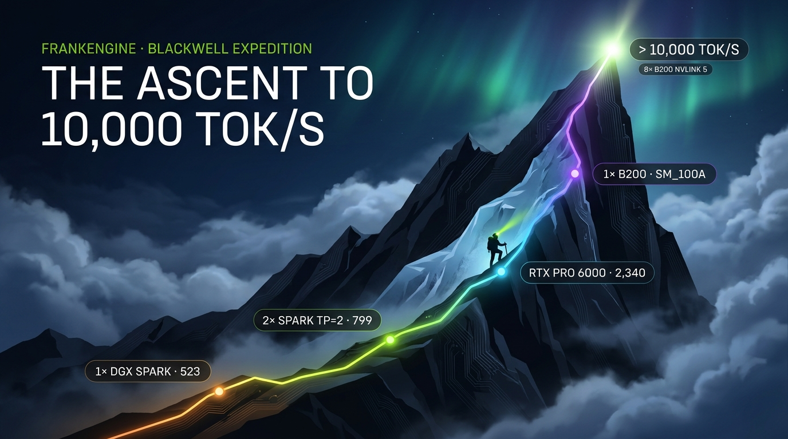

# Frankengine — Engineering Roadmap to `10,000 tok/s`

  

> **Purpose:** Physics-calibrated, milestone-gated engineering plan to reach **`10,000 tok/s`** on `thinkingmachines/Inkling-2-Mini` (`30B-A3.6B` Looped MoE, 48 layer visits/token), grounded in real measurements from **`1× DGX Spark (GB10)`**, **`2× DGX Spark (TP=2 RoCEv2)`**, and **`1× RTX PRO 6000 Blackwell (96 GB)`**.
>
> **Last updated:** 2026-11-27

---

## 1. Two Distinct `10,000 tok/s` Goals

Always separate **aggregate serving throughput** from **single-stream latency throughput** — they sit on completely different hardware curves:

| Goal | Definition | Minimum Hardware | Current Best Measured | Achievable Target |
|---|---|---|---|---|
| **Goal A — Aggregate `10,000 tok/s`** | Multi-user batched serving (`c = 64..128`) | **`1× B200` (192 GB HBM3e)** | `2,340 tok/s` (`c=24`, `1× PRO 6000`) · `799 tok/s` (`c=32`, `2× Spark`) | **`10,000–15,000 tok/s`** (`1× B200`) · **`60K–100K`** (`8× B200`, `DP=8`) |
| **Goal B — Single-Stream `10,000 tok/s`** | `c = 1` (`≤ 100 µs/token`, 1 user!) | **`8× B200` (`TP=8` NVLink 5)** | `398–445 tok/s` (`1× PRO 6000`) · `142–264 tok/s` (`2× Spark`) | **`10,000–12,500 tok/s`** (`8× B200` + `Γ=15` + fused/megakernel) |

> **Hard Physical Wall on `1× B200` for `c = 1`:** Even with `0 µs` launch overhead and `Γ=15` (`M=16`, ~`9 GB` DRAM/HBM3e reads per verify), `9 GB / 8 TB/s = 1.125 ms` minimum HBM read time → realistic `1× B200` `c = 1` ceiling is **`~2,500–4,200 tok/s`**. Reaching **`10,000 tok/s` single-stream (`c = 1`) strictly requires `8× B200 NVLink 5` (`64 TB/s`)**.

---

## 2. Two-Point Calibrated Roofline (What `RTX PRO 6000` Revealed)

With two real single-GPU Blackwell data points on identical code (`spark-bench` FP8, `ALL 73`, `c = 1`):

| Hardware | Streaming BW | SMs | `ALL 73` (`c=1`) | Median Step | `Thinking c=24` | `Decode @128K` (Exact) |
|---|---:|---:|---:|---:|---:|---:|
| `1× DGX Spark (GB10, sm_121a)` | `231.4 GB/s` | `48` | `82.1 tok/s` | `34.0 ms` | `522.7 tok/s` | `42.8 tok/s` |
| `1× RTX PRO 6000 (sm_120a)` | `1,792 GB/s` (`7.75×`) | `188` | `398.4 tok/s` (`4.85×`) | `7.0 ms` | `2,339.9 tok/s` (`4.48×`) | `241.0 tok/s` (`5.63×`) |

Fitting the linear roofline $T_{\text{step}}(BW) = T_{\text{fixed}} + \frac{\text{Bytes}}{BW}$ across both measured GPUs:

$$\text{Bytes}_{\text{eff}} = \frac{34.0 - 7.0}{\frac{1}{231.4} - \frac{1}{1792}} \approx \mathbf{7.17\text{ GB/round}} \qquad \Longrightarrow \qquad T_{\text{fixed}} = 7.0 - \frac{7.17}{1.792} \approx \mathbf{3.00\text{ ms/round}}$$

### Why `T_fixed ≈ 3.0 ms` Is the #1 Enemy of Fast GPUs

| GPU Topology | BW Time (`7.17 GB / BW`) | Current `T_fixed` | Share of Round Spent in `T_fixed` | Out-of-the-Box `c=1` (`2.8–4.5` tok/step) |
|---|---:|---:|---:|---:|
| `1× DGX Spark` (`231 GB/s`) | `31.0 ms` | `3.0 ms` | `9%` | `82–155 tok/s` *(BW-bound)* |
| `1× RTX PRO 6000` (`1,792 GB/s`) | `4.0 ms` | `3.0 ms` | **`43%`** | `398–445 tok/s` *(half launch-bound!)* |
| `1× B200` (`8,000 GB/s`) | `0.90 ms` | `3.0 ms` | **`77%`** | `~800–1,300 tok/s` *(wasted HBM3e!)* |
| `8× B200 TP=8` (`64,000 GB/s`) | `0.11 ms` | `3.0 ms` | **`96%`** | `~1,000–1,500 tok/s` *(completely stalled!)* |

**Where the `3.0 ms` comes from today:**
1. **`SpecLoop::generate_host_verified` (`src/model/spec.cpp`):** Unlike TP=1 DSpark (which uses a device-side CUDA Graph conditional switch with zero CPU roundtrip), solo `DFlash2` still synchronizes the host every round (`proposal_host_` D2H → CPU width dispatch → `set_inputs` H2D → verify → `done_` sync → commit).
2. **`~680` discrete CUDA kernel launches per round:** `48` target visits × `~12` micro-kernels (`mix`, `gates`, `wproj`, `attn`, `wo`, `conv`, `mix`, `gates`, `router`, `moe_select`, `moe_up`, `moe_down`, `conv`) + `~100` `DFlash2` kernels (`commit` + `5` layers + `head` + `selector`). At `~3–4 µs` per launch/barrier boundary, launches alone consume `~2.0–2.5 ms`.
3. **Unfused solo `DFlash2` `M=7` head + commit:** `head::project_nvfp4` materializes `7 × 200K` floats (`5.6 MB`) → `topk_candidates` → `best16` (3 kernels; batch `head_topk16_nvfp4` uses `TM=32` MMA tiles which regressed `M=7` solo by `+0.88 ms`).

---

## 3. Why `Inkling-2-Mini` Fits `8× B200 TP=8` Exactly

Every sharded dimension of both `Inkling-2-Mini` and `DFlash2` divides **cleanly by 8** with zero padding waste:

| Dimension | Full Model (`TP=1`) | Per-GPU Shard (`TP=8`) | Exact? |
|---|---:|---:|---|
| Target Q / KV Heads | `24 Q / 8 KV` (3:1 GQA) | **`3 Q / 1 KV`** | Exact |
| Target MoE Intermediate `I` | `1,152` | **`144`** (9× NVFP4 16-elem blocks) | Exact |
| Target Vocabulary `V` | `200,058` | **`25,008`** (`v_end` padded by 6) | Exact |
| `DFlash2` Q / KV Heads | `32 Q / 8 KV` (4:1 GQA) | **`4 Q / 1 KV`** | Exact |
| `DFlash2` MLP Intermediate `I` | `6,912` | **`864`** | Exact |

---

## 4. Microsecond Budget for `10,000+ tok/s` (`c = 1` on `8× B200 NVLink 5`)

$$\text{tok/s} = \frac{\alpha + 1}{T_{\text{verify,BW}} + T_{\text{NVLS}} + T_{\text{launch}} + T_{\text{draft}}}$$

| Component (`8× B200`, `TP=8`, `M = 16` verify, `Γ = 15` `DFlash2`) | Budget (`µs`) | How It Is Achieved |
|---|---:|---|
| **Target Verify HBM3e Reads** (`~9.0 GB / 64 TB/s` @ 85% eff.) | **`165 µs`** | `sm_100a` `tcgen05` NVFP4/FP8 MMA, 8-way sharded weights + KV |
| **96× Target AllReduces (`NVLink 5 NVLS / SHARP`)** | **`240 µs`** | Hardware `multimem.ld_reduce` / `multimem.st` (`~2.5 µs`/AR, 0 CPU proxy) |
| **Fused Visit Overhead / Persistent Megakernel Barriers** | **`120 µs`** | Fused `mix+gates+norm`, `conv+res`, `router+topk`, persistent loop-core `6..17`, zero host sync |
| **`DFlash2` `Γ=15` Draft (`TP=8` sharded)** | **`190 µs`** | `64 MB/GPU` (`~10 µs` BW) + `10×` NVLS (`25 µs`) + `M=15` fused GEMV top-16 head (`45 µs`) + fused selector (`20 µs`) + commit (`30 µs`) + launch (`60 µs`) |
| **Sharded Head + Exact Sample/Reject (`80 B/row × 16 = 1.28 KB`)** | **`35 µs`** | Single-pass `RejectShardPartial` over `NVLS` allgather (`1.28 KB`/rank) |
| **Total Round Time ($T_{\text{round}}$)** | **`750–850 µs`** | **`0.75–0.85 ms/round`** |

### Resulting Throughput (`c = 1`)

| Drafter Horizon | Expected `α + 1` (Code / Math / Reasoning) | At `0.80 ms/round` | At `0.85 ms/round` |
|---|---:|---:|---:|
| Current `DFlash2` (`Γ = 7`) | `4.5 – 5.5` | `5,625 – 6,875 tok/s` | `5,294 – 6,471 tok/s` |
| **Distilled `DFlash2` (`Γ = 15`, `ARCH-06b`)** | **`8.5 – 10.0`** | **`10,625 – 12,500 tok/s`** | **`10,000 – 11,765 tok/s`** |

*(Even with `Γ = 7`, `8× B200` hits `~6–7K tok/s`; crossing **`10,000 tok/s`** strictly requires **BOTH** `T_round ≤ 0.85 ms` **AND** `Γ = 15` distillation `α + 1 ≥ 8.5`!)*

---

## 5. Phased Execution Plan ("Prove Locally on PRO 6000 First, Rent B200 Last")

Every stage has an objective **Go/No-Go gate** on cheaper hardware before spending compute on the next tier.

### Stage 0 — Kill `T_fixed` (`3.0 ms → < 0.8 ms`) on `1× RTX PRO 6000` (`sm_120a`)
*Zero B200 rental cost! Every microsecond cut here directly compounds on `1× PRO 6000`, `1×/2× Spark`, and `8× B200`.*

- **`S0.1` — Nsight Systems Trace on `1× RTX PRO 6000` (`7.0 ms` round):**
  - Capture exact µs breakdown of `verify` vs `draft` vs `host sync` vs `inter-kernel gaps` on `ALL 73` (`c = 1`) and `Thinking c = 24`.
- **`S0.2` — Zero-Host-Sync Device-Conditional `SpecLoop` for `DFlash2` (`src/model/spec.cpp`):**
  - Port solo `DFlash2` onto `rt_.capture_switch(...)` (same device-side CUDA Graph conditional switch TP=1 DSpark already uses), eliminating per-round `proposal_host_` D2H + `set_inputs` H2D + host roundtrip.
  - Enable `cudaStreamSynchronize`-free pipelined `draft(t+1)` launch before reading round `t` tokens on host.
- **`S0.3` — Per-Visit Micro-Kernel Fusion (`src/kernels/dense/`, `src/model/decoder.cpp`):**
  - Fuse `mix + message_gates + rmsnorm` and `conv1d + residual` inside each visit; fuse `router GEMV + top-8 bias/softmax`.
  - Target: cut `~680` graph nodes per round down to **`< 220`** nodes.
- **`S0.4` — Solo `M=7..15` Native Fused NVFP4 Top-16 Draft Head (`src/kernels/head/`):**
  - Unlike `head_topk16_nvfp4` (which uses `TM=32` batch-MMA tiles and regressed `M=7` solo), write an **`M=7/15` warp-GEMV fused top-16** kernel (no `5.6 MB` intermediate logit buffer, 90%+ DRAM BW) + overlap `DFlash2::commit` with host token emission.
- **Stage 0 Gate (on `1× RTX PRO 6000`):** `ALL 73 (c=1)` **`398 → ≥ 530 tok/s`** (`step ≤ 5.2 ms`, `T_fixed ≤ 1.0 ms`), `Thinking c=1` **`≥ 560 tok/s`**, `quality guard 30/30 PASS`.

---

### Stage 1 — Goal A (`10,000+ tok/s` Aggregate) on `1× B200` (`sm_100a`)
- **`S1.1` — `sm_100a` `tcgen05` Native Blackwell Kernels:**
  - Port `wgemm.cu`, `batch/moe.cu`, `fp8_gemm.cu`, and `head_sample_nvfp4` to `sm_100a` `tcgen05.mma` + TMA multicast (148 SMs, 8 TB/s HBM3e, 228 KiB SMEM/SM).
- **`S1.2` — High-Concurrency `BatchDecoder` (`c = 64..128` in 192 GB HBM3e):**
  - Bucketize `BatchDFlash2` `chunk_keys` so `INGINE_BATCH_DFLASH2_GRAPH=1` works cleanly without graph churn.
  - Scale `--max-batch 128 --batch-ctx 32768 --batch-spec 7` with `D-cut` + single-pass `RejectSpec`.
- **Stage 1 Gate (on `1× B200`):**
  - **Goal A ACHIEVED:** `Thinking c=64..128` **`≥ 10,000 tok/s` aggregate** (`0` errors, `30/30` guard PASS).
  - `c = 1` (`Γ = 7`): **`≥ 1,800–2,400 tok/s`** (`step ≤ 1.5 ms`).

---

### Stage 2 — `8× B200` `TP=8` + `NvlsBackend` (`NVLink 5 SHARP`)
- **`S2.1` — Generalize `TpLayout` & Collectives to `TP ∈ {1, 2, 4, 8}`:**
  - Generalize `model/tp_layout.h`, `model/tp_runtime.cpp`, `model/batch.cpp`, `model/dflash2.cu`, and `head_reject_merge_tpN` (`N`-way merge of `80 B/row` `RejectShardPartial` = `8 × 80 B × 16 = 10 KB` total!).
  - Replace `TpControl` 1-worker pipe with a lightweight `N-1` broadcast controller (or MPI/NCCL bootstrap).
- **`S2.2` — `NvlsBackend` behind `tp_comm::CommBackend`:**
  - Implement NVLink 5 `multimem.ld_reduce` / `multimem.st` (CUDA VMM `CU_MEM_HANDLE_TYPE_FABRIC` multicast objects) with in-kernel spin barriers — **zero CPU proxy, `< 2.5 µs` per AllReduce**!
  - Use `NVLS` for both `96×` target AllReduces, `10×` sharded `DFlash2` AllReduces, and `RejectShardPartial` allgather.
- **Stage 2 Gate (on `8× B200` with existing `Γ = 7` `DFlash2`):**
  - `c = 1` round time **`≤ 0.80 ms`**, single-stream Code/Refactor **`≥ 6,000–7,000 tok/s`**, `33/33` golden & `30/30` guard PASS.

---

### Stage 3 — Break the `Γ = 7` Acceptance Ceiling (`ARCH-06b`: Distilled `Γ = 15` `DFlash2`)
*Can be trained in parallel during Stage 1–2 on 1×/8× H100/B200 (~1–2 days of distillation).*

- **`S3.1` — Distill `Inkling-2-Mini-DFlash2-G15` (`BLOCK = 16`, `Γ = 15`):**
  - Train a 5-layer block-diffusion `DFlash2` student (`block_size = 16`, sliding window `4K–8K` to also fix the `2K` distant-context drop!) via target-logit KL distillation on `Inkling-2-Mini` rollouts (code, math, multi-step thinking, chat).
  - *Note (`DEAD-07`):* Never widen pretrained `Γ = 7` weights without retraining (proven `-4% to -11%` regression).
- **`S3.2` — Engine `BLOCK = 16` Support (`Decoder`, `SpecLoop`, `DFlash2`):**
  - Extend `verify_widths` to `{2, 4, 6, 8, 12, 16}` and update `dflash2_fused_selector` (`15 × 16 = 240` edges in 1 block!).
- **Stage 3 Gate (offline + live `8× B200`):**
  - Measured `α + 1 ≥ 8.5` on code/math/thinking (vs `4.5–5.5` for `Γ = 7`).
  - `M = 16` verify overhead on `8× B200` `≤ +100 µs` vs `M = 8`.

---

### Stage 4 — Persistent Loop-Core Megakernel + Speculative Pipelining → **`10,000+ tok/s` `c = 1`**
- **`S4.1` — Persistent `sm_100a` Loop-Core Megakernel (`layers 6..17 × 3`):**
  - Keep all `148` B200 SMs resident across the 36 looped visits with inline `multimem` NVLS reductions and software work-queues (eliminating remaining CUDA graph node transition latency: `120 µs → < 40 µs`).
- **`S4.2` — Speculative Draft Pipelining (optional final boost):**
  - Overlap `DFlash2` draft for round `t+1` on a secondary SM partition (CUDA Green Contexts on B200) or speculatively from the predicted high-confidence tail token.
- **Final Qualification Gate (Goal B ACHIEVED):**
  - **`c = 1` sustained `≥ 10,000 tok/s`** (`≤ 100 µs/token`) on `8× B200 NVLink 5`, `0` errors, `128K/240K` needles `PASS`, `quality guard 30/30 PASS`, `inkqc ≥ 285/295`.

---

## 6. Key Risks & Mitigations

| Risk | Impact | Mitigation |
|---|---|---|
| **96 AllReduces dominate `TP=8` even over NVLink 5** | If `NVLS` AR is `4 µs` instead of `2.5 µs` → `+144 µs` (`0.95 ms` round) | Fuse `NVLS` directly into `Wo`/`MoE W2` epilogues (zero separate comm kernel launch!) + use `FP16/BF16` wire on MoE (`DEAD-02`: keep `Wo` FP32). |
| **Distilled `Γ=15` `DFlash2` plateaus at `α + 1 ≈ 6.5–7.5` on prose** | `c=1` hits `10K+` on code/math/thinking, `~8K` on high-entropy prose | Use 2-pass iterative diffusion refinement on positions `8..15` (`+40 µs` draft) + exact Leviathan rejection sampling (Track #4) + `4K–8K` drafter window. |
| **MoE `E_uniq(16)` increases DRAM bytes at `M = 16`** | `E_uniq` grows `30.6 → 45.3` (`+48%` MoE bytes) | At `64 TB/s`, `+48%` of `110 µs` is only **`+53 µs`** — easily paid for by `+70%` higher `α + 1`! |
| **Host/HTTP overhead caps real SSE `c = 1` below engine speed** | Fast engine bottlenecked by JSON/HTTP framing at `10K tok/s` | Emit multi-token SSE chunks per accepted verify block (1 SSE event per round = `~1.2K` events/sec, not `10K`), keeping HTTP overhead `< 20 µs`. |
